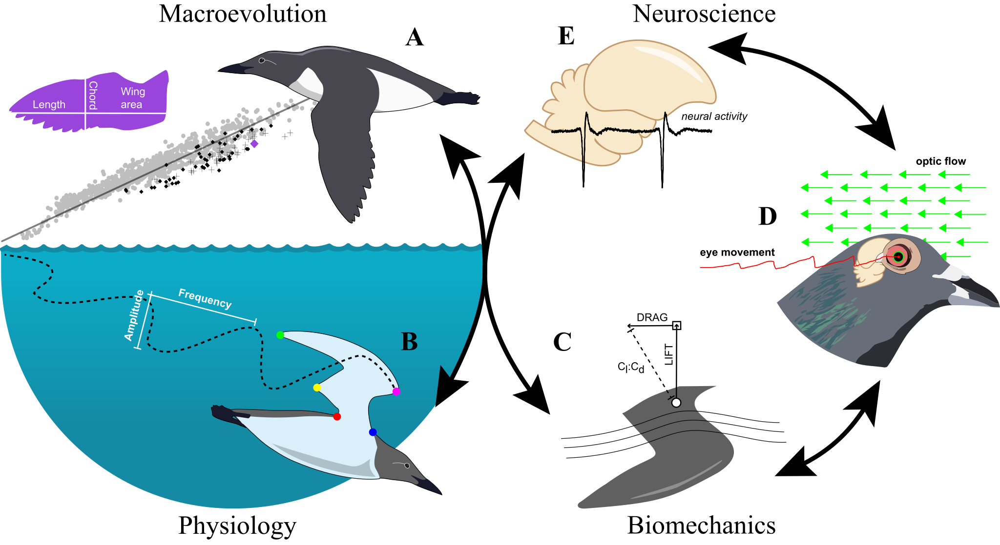

Animal locomotion is remarkably diverse across species and complex within individuals. For most animals, movement is also crucial for survival, reproduction, and consumes a significant proportion of energy. Thus, the demands to move are reflected across morphology, physiology, and neurobiology. At the same time, the ways to measure locomotor abilities – performance (e.g., speed) and efficiency (e.g., cost of transport) – are well-defined. For these reasons, by studying animal locomotion, we not only gain insight into a charismatic and essential animal behavior; we gain a tractable system to dissect the details of evolution. 

My research investigates how locomotor structures change through time (macroevolution), power movement in extant species (physiology & biomechanics), and are controlled in nature (neuroscience). 

------------------------------------------------------------------------

{width=100%}

------------------------------------------------------------------------

### Ongoing projects