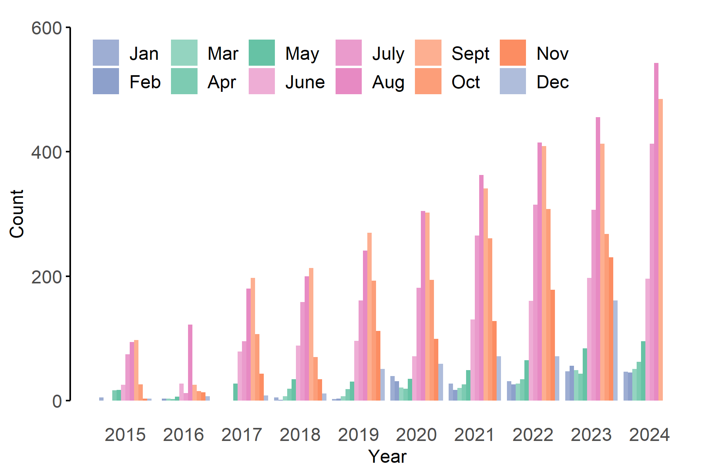
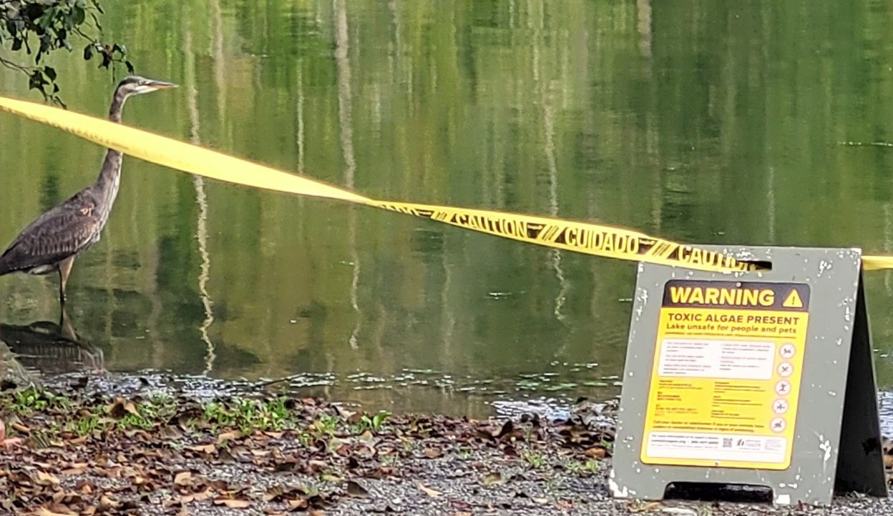
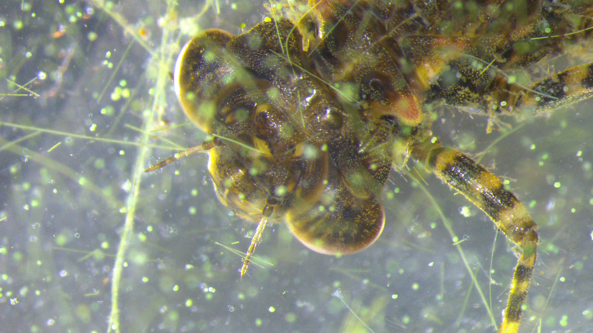
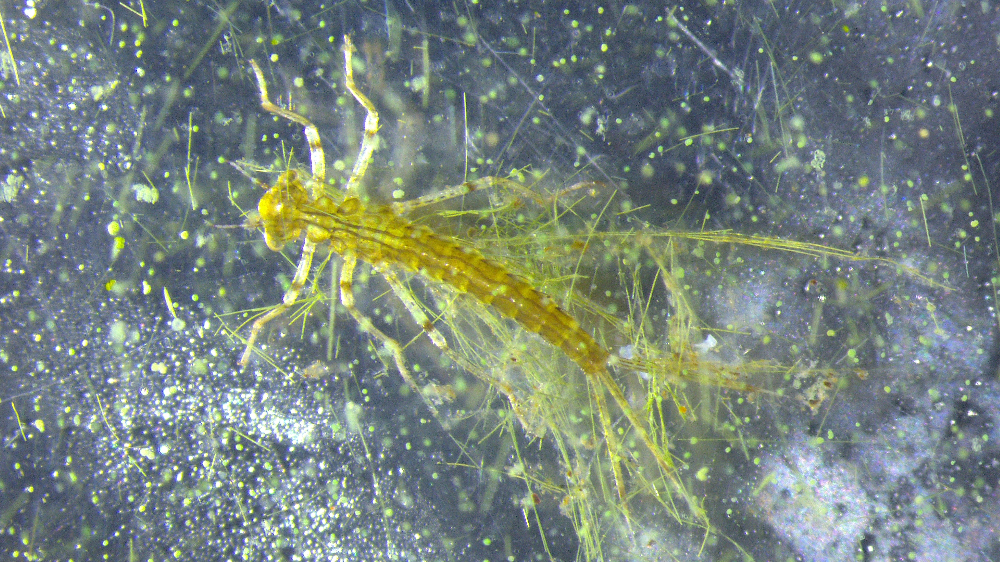

# Dragonflies and damselflies as sentinels of cyanotoxins

Toxins produced by harmful blue-green algae, known as cyanotoxins, pose an escalating threat to freshwater ecosystems. Insects are vital components of freshwater ecosystems, linking food webs between microscopic organisms and larger consumers, and cycling nutrients between aquatic and terrestrial habitats. Consequently, the resilience of freshwater ecosystems will depend on the sensitivity of insects to cyanotoxins; yet, we know surprisingly little about how cyanotoxins impact insect survival, development, performance, or fitness.

In addition to being critical components of the landscape, freshwater ecosystems provide drinking water, irrigation, and recreation. For Indigenous communities, these environments are also key to climate resiliency and food sovereignty, directly and indirectly supplying resources necessary for subsistence, ceremonial, and commercial harvests. The prevalence of harmful blue-green algae and their biotoxins are increasing rapidly, with a 5-fold increase in cyanotoxin events reported in the US over the last 10 years. It is, therefore, crucial to determine how cyanotoxins affect insects, the extent to which insects transfer cyanotoxins through food webs, and which traits predispose species to cyanotoxin susceptibility.

{width=80%, .lightbox}

State and Federal agencies restrict public access to lakes and rivers if cyanotoxin concentrations reach harmful levels. However, this system does not protect aquatic organisms from cyanotoxins or prevent these toxins from leaving through outflow.

{width=80%}

With support from Lummi Natural Resources, the goal of this project is to investigate the effects of cyanotoxins on aquatic insects, focusing on the survival, development, and fitness of dragonflies and damselflies—key freshwater insect groups. These animals, collectively called "odonates", have proven to be valuable indicators for other contaminants, including [mercury](https://geonarrative.usgs.gov/dmp/). This work will also provide hands-on learning opportunities for Indigenous students, fostering leadership, scientific expertise, and career readiness in agriculture, resource management, and academic research.

::: {#fig-odonates layout-ncol=2}

{#fig-dragon}

{#fig-damsel}

Juvenile odonates tangled in filaments of cyanotoxin-producing harmful algae, Oscillatoria sp. Pass Lake, WA.

:::

